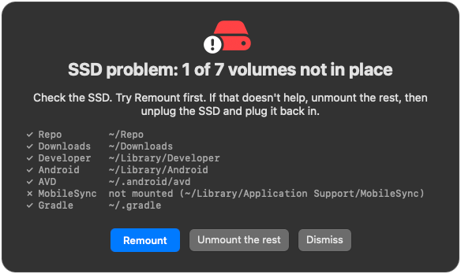
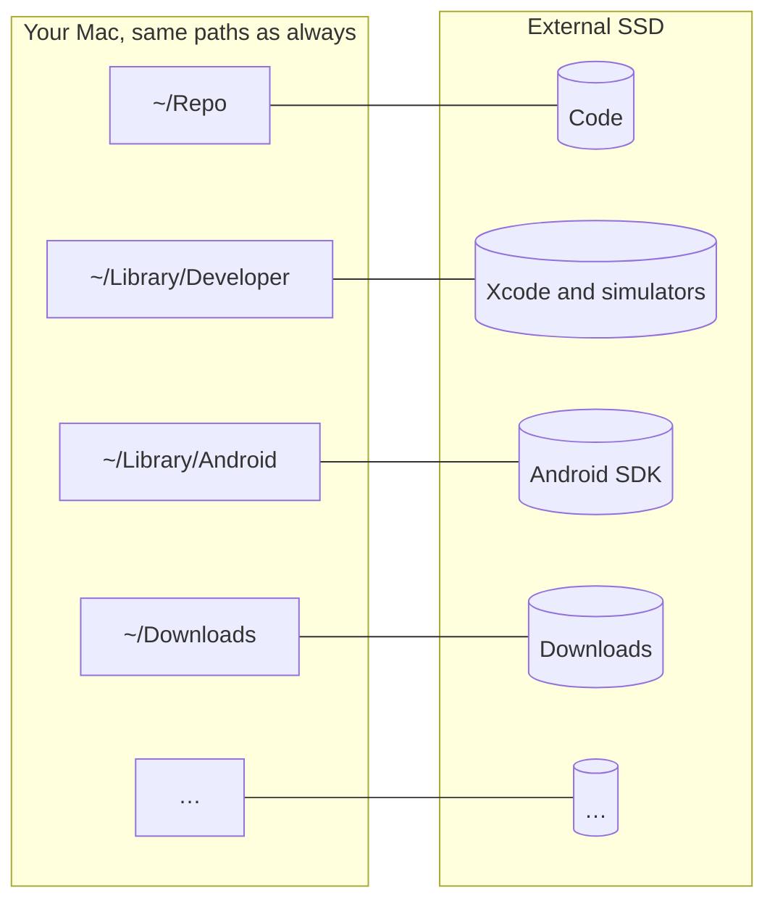
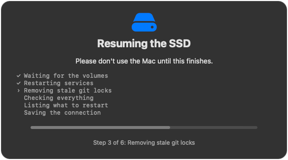
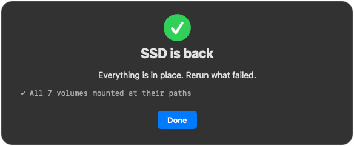
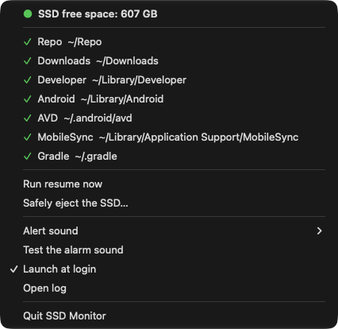

# External SSD plan, and SSD Monitor

**Move the big developer folders off your Mac onto an external SSD, without changing how you work, and recover
by itself when the cable gets pulled.**

Our Macs kept running out of disk space. Cleanups helped for a week or two, then the disk was full again. The
biggest users were developer folders: code with its `node_modules`, Xcode and simulators, the Android SDK and
emulators, build caches, iPhone backups.

So we moved those folders onto an external SSD that stays plugged in. This repo holds what we learned doing it,
and a small menu bar app, **SSD Monitor**, that keeps an eye on the SSD.

<p align="center">
  
</p>

## 🎯 The goal

| | |
|---|---|
| **Free as much space as possible** | On the first Mac, free space went from **5.5 GiB to 299 GiB**. |
| **Nothing changes in daily work** | Every folder is still at the same place, so apps, scripts and agents don't notice the move. |
| **Unplugging is not a disaster** | If the cable gets knocked out, whatever was running in those folders may fail. Plug the SSD back in and everything picks up again: no reboot, nothing to fix by hand, no duplicate folders. Whatever failed just works when you run it again. |

## 🛠️ How we got there

### 1. One part of the SSD per folder

Each big folder gets its own volume on the SSD. The volumes share the SSD's space, so none of them can fill up
before the others.

### 2. Each part shows up exactly where the old folder was

The Mac attaches the code volume at `~/Repo`, the Xcode one at `~/Library/Developer`, and so on. It isn't a
shortcut or an alias: the folder really is there. Apps can't tell the difference, and the Mac attaches everything
by itself whenever the SSD is plugged in.



### 3. Move only what can safely disappear for a moment

| Moves to the SSD | Stays on the Mac |
|---|---|
| Code and its dependencies | Settings and dotfiles |
| Xcode data and simulators | Coding agents' memory and rules |
| Android SDK and emulators | Mail and other app data |
| Build caches | The recovery tools themselves |
| Downloads, iPhone backups | |

Code, caches and simulators can be missing for a minute and come back. Settings can't: some apps reset or
overwrite them if they disappear.

> [!TIP]
> The rule of thumb: if something would need fixing by hand after a replug, it stays on the Mac.

### 4. Copy, check, then switch

There was a backup first, just in case. Then everything was copied to the SSD and checked file by file before any
original was deleted. Each folder was switched over to its SSD volume, the small ones first.

### 5. Lock the empty spots

While the SSD is unplugged, those folders are empty and locked on the Mac. Nothing can be saved there by
mistake, so there are no duplicate folders to sort out later.

### 6. Recover by itself


After a replug, SSD Monitor cleans up what the interruption broke:
- it restarts the background services that had files open
- it removes leftover lock files from interrupted git commands
- it checks that everything is in place
- it tells you which apps to reopen

## 🖥️ SSD Monitor

A small app in the menu bar. While everything is fine you don't see it, and it uses no CPU at all while it
waits.

<table>
  <tr>
    <th>Menu bar icon</th>
    <th>Meaning</th>
  </tr>
  <tr>
    <td align="center"></td>
    <td>Everything is in place.</td>
  </tr>
  <tr>
    <td align="center"></td>
    <td>The SSD is unplugged, or a folder is missing. It stays red until that's fixed, even after you dismiss the alert.</td>
  </tr>
  <tr>
    <td align="center"></td>
    <td>Recovering after a replug.</td>
  </tr>
</table>

### When something goes wrong

A full-screen alert with a sound, like the one at the top of this page.
- **A folder is missing:** the alert offers **Remount** to fix it, **Unmount the rest** to disconnect safely, or
  **Dismiss**.
- **The whole SSD is unplugged:** the alert tells you to plug it back in. Nothing else to do.

### When the SSD is back

It runs the recovery by itself. When it's done, it shows a green check and anything that may need a restart.

<p align="center">
  
  &nbsp;
  
</p>

### The menu

The SSD's free space, each folder's state, and a few actions.

<p align="center">
  
</p>

> [!NOTE]
> Unplugging on purpose? Choose **Safely eject the SSD…** in the menu first. Then there is no alert while it's
> away, and the recovery runs when you plug it back in.

## 🚀 Doing this on your Mac

Every Mac has different folders, tools and space, so don't copy our setup as is. Let your coding agent work it out
with you.

1. Open this repo in **Claude Code** or **Codex**. Both read the full guide in [`AGENTS.md`](AGENTS.md) by
   themselves.
2. Ask:
   ```text
   Read the guide and help me move my developer folders to my external SSD the same way.
   ```
3. The agent looks at your Mac, suggests what to move and how much space you'll get back, and asks before
   anything risky. You type your admin password for a few steps.

**What you need:**
- an external NVMe SSD, plugged **directly** into the Mac (not through a hub)
- a backup of the folders that will move
- a few hours, mostly copying, while you keep working

> [!WARNING]
> During the move, the Mac's free space can drop a lot, especially with many apps open. On our Mac it fell to
> 5.5 GiB at one point. Free a little space first, close heavy apps, and keep an eye on it.

## 📁 What's in this repo

| | |
|---|---|
| [`AGENTS.md`](AGENTS.md) | The full technical guide, written for coding agents: the plan, every step, what we tested and learned, and how the app works |
| [`CLAUDE.md`](CLAUDE.md) | Points Claude Code to `AGENTS.md` |
| [`Sources/`](Sources/) | The app |
| [`helpers/`](helpers/) | The scripts that do the actual disk work. They also run on their own in a terminal. |
| [`scripts/`](scripts/) | Build and install |
| [`docs/images/`](docs/images/) | The pictures on this page |

## License

[MIT](LICENSE)
